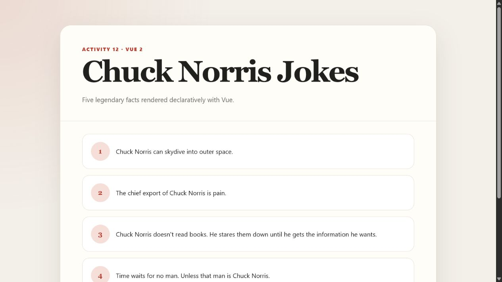
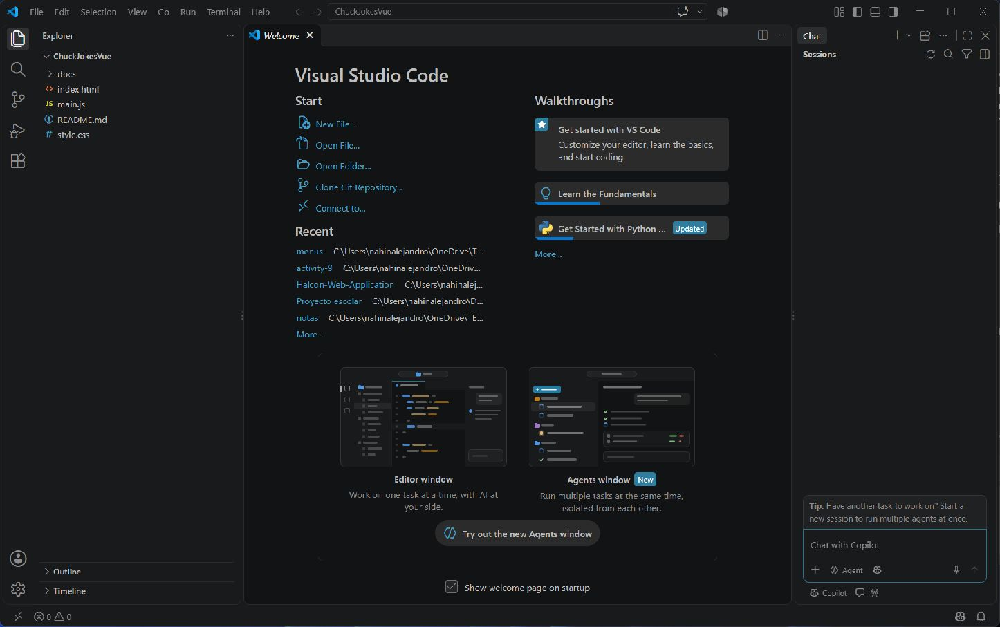
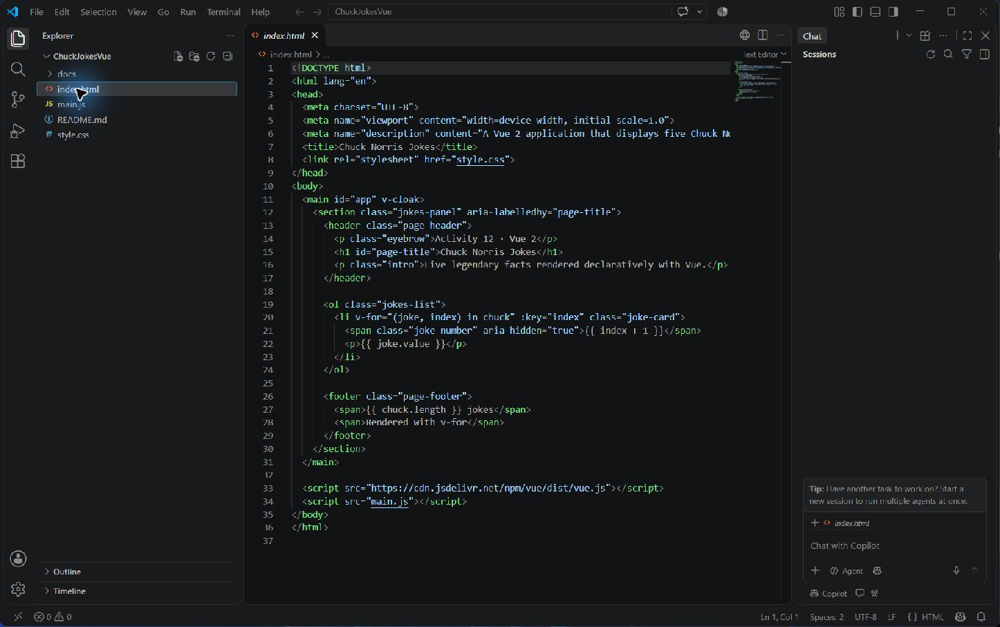
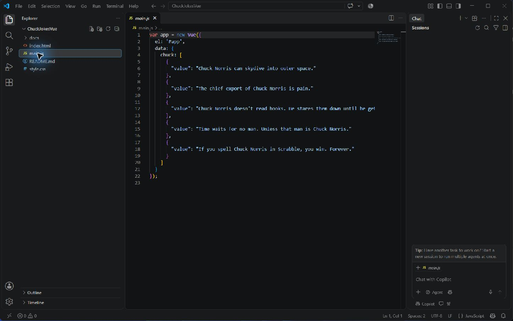

# Actividad 12

## Objective

Desarrollar una aplicación sencilla con Vue 2 que muestre las cinco frases de Chuck Norris proporcionadas en la actividad. La solución practica la creación de una instancia Vue, el uso de `data`, el renderizado declarativo mediante `v-for` y la aplicación de estilos CSS.

## Development

El proyecto se creó como una aplicación web estática sin Laravel, Vue CLI ni Vite. `index.html` integra Vue 2 mediante CDN y contiene el elemento `#app`. Dentro de ese elemento, una lista ordenada utiliza `v-for="(joke, index) in chuck"` para recorrer los datos.

`main.js` crea una instancia con `new Vue`, enlaza la aplicación con `el: '#app'` y define el arreglo `chuck` dentro de `data`. El arreglo contiene exactamente las cinco frases indicadas en las instrucciones oficiales.

`style.css` aplica un diseño limpio con contenido centrado, tarjetas separadas, números visibles, tipografía legible, fondo suave y reglas responsive para pantallas pequeñas. No se utilizaron frameworks CSS externos.

## Evidence

### Application running

La aplicación muestra las cinco frases renderizadas por Vue.

### Project structure

La estructura mantiene únicamente los archivos y la documentación requeridos.

### v-for directive

El código HTML recorre el arreglo `chuck` mediante la directiva `v-for`.

### Vue instance

La instancia de Vue contiene el arreglo con las cinco frases oficiales.

### GitHub repository

La captura del repositorio se agregará después de crear y publicar el repositorio remoto. No se incluye una evidencia simulada.

## GitHub

URL esperada: <https://github.com/AlejandroVela333/ChuckJokesVue>

Estado actual: pendiente de creación manual del repositorio vacío.

## Conclusion

La actividad implementa una instancia Vue 2 sin herramientas de compilación. Los datos permanecen en JavaScript y la interfaz los presenta mediante `v-for`, lo que demuestra el flujo básico de renderizado declarativo y la separación entre estructura, datos y estilos.
